# iRoof.top



Talk to the people you miss. Export a Telegram or WhatsApp chat, and **iRoof.top** continues it with an LLM that writes
in the style of one participant. That can be the other person, or you ("chat with myself in their style").
It roughly gauges the person's knowledge level, vocabulary and habits, then replies the way they would: in
several bubbles, with their stickers, GIFs, reactions, replies and forwards.

* Single Rust binary (`rooftop`) with an embedded web UI (light and dark), JSON-file storage, and multiple chats.
* Any **OpenAI-compatible** `/chat/completions` endpoint (OpenAI, OpenRouter, Ollama, vLLM, LM Studio…).
* **MCP client** for all 2024–2026 revisions: `2026-07-28` (stateless), `2025-11-25`, `2025-06-18`,
  `2025-03-26` and the deprecated `2024-11-05` HTTP+SSE, over Streamable HTTP or stdio. MCP tools
  such as a Giphy server let the persona find and send GIFs that were never in the export.
* **Share links** (`/s/<name>`) with an optional PIN, so friends can talk to the persona without seeing anything else. A link
  like `/s/<name>#name=Greg&pin=123456` opens the chat right away. The PIN goes after `#` so it never reaches the server or
  proxy logs. The name also works as `?name=Greg`.
* Minimal Alpine Docker image, and a **desktop app** (Tauri 3) for macOS, Windows and Linux.

## Install

```sh
brew install irooftop/tap/rooftop            # the server, macOS and Linux (then: brew services start rooftop)
brew install --cask irooftop/tap/irooftop    # the desktop app, macOS
cargo install rooftop                        # the server, anywhere with Rust ≥ 1.88
docker pull ghcr.io/irooftop/rooftop         # the server as a container, see Docker below
```

Desktop installers for macOS, Windows and Linux are on the [Releases](https://github.com/irooftop/rooftop/releases) page.

## Quick start

```sh
export OPENAI_BASE_URL=https://openrouter.ai/api/v1 OPENAI_API_KEY=… OPENAI_MODEL=openai/gpt-6-luna   # or put them in ./.env
rooftop --import "./examples/telegram"   # the bundled example, from a clone of this repository
# open http://127.0.0.1:8080
```

You can also start the server without `--import` and drop the export folder, a `.zip` or a WhatsApp `.txt` onto the page.
Prefer a ready-made app? Use the [desktop app](#desktop-app) or the [Docker image](#docker).

The folder [`examples/`](examples) holds two fictional chats you can import right away, listed with their habits in
[`examples/README.md`](examples/README.md). `examples/telegram` is a two-day Telegram export in which Jonas and Priya
cook a lasagna together, with photos, stickers, GIFs, a voice message, a round video, a video, a PDF, music, a forwarded
post, a link preview and reactions. Jonas writes in lowercase bursts, stretches words ("yesss") and never uses a question
mark. Priya writes full sentences, plans in numbered lists and answers "Noted." `examples/whatsapp` is an Android export
of a chat between Sofia and Daniel, who sign off with a heart and an "x" respectively.

### Exporting a chat



**Telegram Desktop** (macOS, Windows, Linux): open the chat → **⋯** → **Export Chat History…** → **Export**.
Keep photos, videos, voice messages, stickers and GIFs switched on. Both formats work: **HTML** (`messages.html`)
and machine-readable **JSON** (`result.json`). Drop the export folder, or a `.zip` of it, onto the page.

**WhatsApp** (phone): open the chat → **⋮ → More → Export chat** (iPhone: tap the contact name → **Export Chat**)
→ **Include media**. Send the resulting `.zip` to your computer and drop it onto the page. A chat exported without
media is a single `.txt`, and that works too.

### Docker

```sh
docker run -d --name rooftop -p 8080:8080 \
  -e OPENAI_BASE_URL=https://openrouter.ai/api/v1 -e OPENAI_API_KEY=… -e OPENAI_MODEL=… \
  -e ROOFTOP_PASSWORD=change-me -e TZ=Europe/Berlin \
  -v rooftop-data:/data \
  -v "$PWD/examples/telegram:/import/chat:ro" -e ROOFTOP_IMPORT=/import/chat \
  ghcr.io/irooftop/rooftop:latest
```

The image `ghcr.io/irooftop/rooftop` is published for linux/amd64 and linux/arm64. Tags are `latest`, `X.Y.Z` and `X.Y`.
The image has no Node.js and no ffmpeg. To use stdio MCP servers started with `npx`, extend it (`FROM ghcr.io/irooftop/rooftop` +
`RUN apk add nodejs npm`), or use a remote (HTTP) MCP server instead. To describe GIFs and videos from their frames,
add `RUN apk add ffmpeg` the same way.

### On a server with HTTPS

[`deploy/`](deploy) runs iRoof.top behind [Caddy](https://caddyserver.com), which gets and renews the TLS certificate:

```sh
cd deploy
sed -i 's/example.com/your.domain/g' Caddyfile        # the domain must already point at the server
printf 'ROOFTOP_PASSWORD=%s\n' "$(openssl rand -base64 24)" > iroof.env && chmod 600 iroof.env
docker compose up -d
```

Share links then use your domain (`https://your.domain/s/<name>`). The owner UI asks for the password, while share
links, `/healthz` and the page assets stay public. The container runs read-only, without capabilities and with a memory
limit, and `ROOFTOP_TRUST_PROXY` is on because Caddy sets the visitor's IP. Update with
`docker compose pull && docker compose up -d`. Back up the `iroof-data` volume, which holds the exports, chats and
settings.

### Configuration

| Variable | Default | Meaning |
|---|---|---|
| `OPENAI_BASE_URL` | `https://openrouter.ai/api/v1` | Any OpenAI-compatible base URL: OpenAI, OpenRouter, Gemini, Mistral, DeepSeek, Groq, Ollama, LM Studio, vLLM… |
| `OPENAI_API_KEY` | – | Bearer token |
| `OPENAI_MODEL` | `openai/gpt-6-luna` | Model id at that endpoint (must support tool calling) |
| `OPENAI_TEMPERATURE` | provider default | Sampling temperature |
| `OPENAI_MEDIA_MODEL` | `OPENAI_MODEL` | Model that describes images and transcribes voice messages (must accept images and audio, e.g. `xiaomi/mimo-v2.6-flash`) |
| `ROOFTOP_ADDR` | `127.0.0.1:8080` (`0.0.0.0:8080` in Docker) | Listen address. With `0.0.0.0:<port>` the log shows the Wi-Fi/LAN URL to open on other devices |
| `ROOFTOP_DATA` | `./data` (`/data` in Docker) | Exports, chats, settings |
| `ROOFTOP_IMPORT` | – | Export dir(s) to import on start, `:`-separated (idempotent) |
| `ROOFTOP_PASSWORD` | – | Enables HTTP Basic auth (any user name). **Set it on a public server.** |
| `ROOFTOP_MAX_UPLOAD_MB` | `2048` | Upload limit |
| `ROOFTOP_TRUST_PROXY` | `false` | Take the client IP for PIN throttling from `X-Forwarded-For` / `X-Real-IP`. Enable only behind a reverse proxy |
| `ROOFTOP_FFMPEG` | `ffmpeg` on `PATH`, then Homebrew / `/usr/local` / `/usr/bin` | ffmpeg binary for describing GIFs and videos from their frames (optional) |
| `TZ` | UTC | Time zone for live message timestamps |
| `TELEGRAM_BOT_TOKEN` | – | Bot token from [@BotFather](https://t.me/BotFather): relays share links to a Telegram group (see below) |
| `TELEGRAM_CHAT_ID` | any group the bot joins | Allowed group id(s), comma-separated |
| `TELEGRAM_API_URL` | `https://api.telegram.org` | Bot API base URL (e.g. a self-hosted Bot API server) |

Values set in the UI (Settings) override the environment. That covers the LLM endpoint, model, key and
temperature, the history budget, the number of tool steps per answer, and MCP servers.

### Answer visitors from Telegram

With `TELEGRAM_BOT_TOKEN` set, a share link can send its visitors' messages to a Telegram group instead of letting
the AI answer right away. Create a group, add the bot to it, then pick the group under **Share → Telegram group**.
Each visitor message appears in the group with two buttons:

* **✍️ Reply**: stops the countdown and asks you for the answer. Your text reaches the visitor as a message from the
  persona. There are three ways to answer:
  1. reply to the bot's "✍️ … reply to this message" prompt;
  2. reply to the visitor's message itself (or to an AI answer), at any time and without pressing Reply;
  3. just send a message after pressing **Reply**. For 15 minutes your plain messages go to that visitor, and for 2 more
     minutes after each answer, so an answer can span several messages. Other people's messages, and yours once the AI
     has answered, stay in the group. Telegram delivers plain group messages to bots only with privacy mode off
     (@BotFather → `/setprivacy` → Disable, then re-add the bot) or when the bot is a group admin. The prompt says
     which ways work in your group.
* **🤖 AI reply (10 s)**: the AI answers now. If nobody presses anything, it answers when the countdown ends
  (set the delay per link, `0` = only on request). The buttons then disappear, and the AI's answer is posted to the group.

Visitors see the same "typing…" for both cases and can't tell who answered. That makes a "human or AI?" guessing game,
or a support desk where the agent handles the obvious questions. With Telegram's default privacy mode the bot still sees
button presses and replies to its own messages, so ways 1 and 2 always work. Updates arrive by long polling, so you don't need a
public URL or a webhook. Anyone in the group can answer, so use a group you trust. Only text answers are relayed,
and AI answers count against the link's answer limit.

## How a chat becomes `messages`

Every supported export is turned into the same normalized messages:

* **Telegram HTML**: `messages.html` (plus `messages2.html`, …), from Telegram Desktop on macOS, Windows or Linux.
* **Telegram JSON**: `result.json`, used when a folder has no `messages.html`.
* **WhatsApp**: `WhatsApp Chat with <name>.txt` (Android) or `_chat.txt` (iOS) with the attached files, in a folder,
  a `.zip` or as a lone `.txt`. Android and iOS layouts, 12- and 24-hour clocks and both day/month orders are
  detected per file. Multi-line messages, edits, attachments and system lines are kept. Deleted messages and the
  end-to-end encryption notice are skipped, and media left out of the export (`<Media omitted>`) is marked as unavailable.

For Telegram the parser handles text with line
breaks, links, quotes and code; replies (`reply_to`) and partial quotes; forwards (both export layouts);
edits; joined messages (sender inherited); service messages; reactions; link previews; and media: photo,
video, round video, voice, audio, file, sticker (`.webp`, `.webm`, `.tgs`), GIF, location, contact, poll and call.
Media files are hashed, so a sticker sent five times becomes one library item (`stk_…`, `gif_…`, `pho_…`, …).

Every action of the persona is replayed as a **tool call**. The model learns *how* the person interacts, not
just what they write, and answers the same way:

| Telegram action of the persona | Tool call in history and in live answers |
|---|---|
| text bubble (optionally a reply / partial quote) | `send_message {text, reply_to?, quote?}` |
| sticker | `send_sticker {sticker_id, reply_to?}` |
| GIF (library, or a URL from an MCP tool) | `send_gif {gif_id \| url, caption?}` |
| photo / video / voice / audio / file | `send_media {media_id, caption?}` |
| forwarded post | `forward_message {message_id}` |
| reaction / like | `react {message_id, emoji}` |
| (recall older history) | `search_history {query}` |

Several calls in one turn are several bubbles. The other side's messages become compact `user` lines such as
`#52108 19:08 ↩ reply to #52107 (your: "grandmas lasagna 🍝"): You have made lasagna exactly zero times.`,
`<sticker stk_156dbb381a>` (followed by `: description` once the library is described) or `reacted 😂 to #52107 ("grandmas lasagna 🍝")`. The ids are what `reply_to`, `react` and `forward_message` expect.

HTML exports don't say who left a reaction. In one-to-one chats a reaction is attributed to the other
participant, and to both when the count is 2. It is placed before that person's next action.

The system prompt asks the model to estimate the persona's knowledge level and style, and never to know more
than they would. It also contains a style profile computed from the *whole* export (message length,
capitalisation, punctuation, emoji and sticker usage, reply and reaction habits, bubbles per turn, verbatim
samples), the sticker/GIF/media library with usage context, and optional notes you write about the person.

The system prompt is **static** for a chat. It has no clock and no counters, so providers' prompt caches keep
hitting. The model reads the date and time from the `— day —` separators and the `HH:MM` stamps of the newest
messages, and each request is a byte-identical prefix of the next one.

**Long chats (memory).** When the replayed history grows past the history budget, the next reply first makes
one extra LLM call. That call folds the oldest turns, plus the previous memory, into a short summary
(≤ ~350 words: relationship, facts, ongoing topics, running jokes, emotional state). The summary is stored with
the chat and placed in front of the first kept turn. The history is cut down to 60% of the budget, so the cut
point and the cached prefix stay put for a long stretch of conversation, not just one turn. This runs lazily:
importing a chat or opening it costs no tokens. The style profile always comes from the whole export, and
`search_history` still reaches every old message. Provider-reported `usage` (prompt, cached and completion
tokens) is kept per chat and shown by the `{ }` view.

**Media library** (the image button in the chat header, or *Imported exports → Media*). The persona model only
reads text, so in the history a sticker is just `<sticker stk_…>`. This view shows every sticker, GIF, photo
and video with the one-line description the model sees. **Describe with AI** sends the images of the missing items
to the configured model, which must support vision. Telegram and WhatsApp export GIFs as `.mp4`, which no vision model
accepts, so GIFs, video stickers and videos go as 4 evenly spaced frames in order, and the model sees the motion.
This needs [ffmpeg](https://ffmpeg.org) (`brew install ffmpeg`, `apt install ffmpeg`, `winget install ffmpeg`).
Without it they fall back to their thumbnail, if the export has one. **Redo** describes one item again, and you can
edit any description by hand. Descriptions are saved with the export and used by all its chats.

CLI equivalents:

```sh
rooftop parse  "./examples/telegram"                             # normalized JSON
rooftop convert "./examples/telegram" --persona "Jonas Weber"     # {model, messages, tools}
```

In the UI, the `{ }` button shows the exact JSON sent to the LLM for the current chat.

## Share links

Use **Share** in the chat header to let other people talk to a persona. Two examples:

* You export a chat with a friend and create a chat in which the AI writes as you. Then you send the friend a link and a
  PIN, and they judge how well it writes in your style.
* You create a chat in which the AI writes as your friend and send them the link, so they talk to a copy of themselves.

A link is `https://<your host>/s/<name>`. You can pick the name (`alex`) or leave it random. Options:

| Option | Default | |
|---|---|---|
| Name visitors see | persona name | Shown in the header and on the start page. The real names from the export are not shown. |
| PIN | none | 4–64 characters, stored as an Argon2id hash. **Generate** makes a 6-digit PIN. Right after saving you can copy an invite with the PIN. |
| Conversations | separate | **Separate**: each visitor gets their own conversation, which starts after the end of the export. **Room**: all visitors write into one conversation and see each other's messages and names. |
| Visitors can read the export | no | `no`, the last *N* messages, or everything. The persona always knows the whole export and your notes. |
| Limits | 50 conversations, 200 answers each | Every answer costs tokens on your key. `0` means unlimited. |
| Expires / active | – / on | Turn a link off or let it expire without deleting it. |

Visitors see only the chat. They get no sidebar, settings, notes, media descriptions, LLM prompt (`{ }`),
token usage, provider errors or other chats. They can load only the media they may see: stickers and GIFs for
the picker, the persona's own media, and media in the visible history. The visitor URL `/s/<name>/<token>` holds
a random 26-character session token. The browser remembers it, so a visitor can continue later, and
`Referrer-Policy: no-referrer` keeps it from leaking. An invite can carry the PIN in the fragment
(`/s/alex#pin=2468`), which is never sent to the server.

You can read every visitor conversation from the Share dialog (**Read**), and **End** one to revoke its token.
Notes you edit on the chat apply to its visitor conversations too. Deleting the chat deletes its links and their
conversations.

**PIN brute-force protection.** Each wrong PIN counts against that client IP and against the link as a whole:

* After 5 wrong PINs from one IP, that IP is locked out for 1 minute, then 2, 4… up to 1 hour.
* After 20 wrong PINs within 15 minutes from all IPs together, the link is locked for 5 minutes, then doubling up to 24 hours.
* Unknown session tokens are throttled per IP.
* Visitors can send at most 30 messages and request 10 answers per minute, and can create at most 20 conversations per hour per IP.
* Counters live in memory and reset when the server restarts.

The link-wide lockout means an attacker can keep a link locked, but cannot guess a 6-digit PIN in any
reasonable time.

Behind a reverse proxy, set `ROOFTOP_TRUST_PROXY=true` so the counters see real client IPs. `ROOFTOP_PASSWORD`
protects the owner UI and API. Share links, `/app.js` and `/app.css` stay reachable without it. Links only work
for others when your server is reachable from their side. The desktop app runs on `127.0.0.1`, so use a server or
a tunnel for that.

## MCP (e.g. Giphy)

Settings → *MCP servers* accepts the common `mcpServers` JSON:

```json
{
  "giphy":  { "command": "npx", "args": ["-y", "mcp-server-giphy"], "env": { "GIPHY_API_KEY": "…" } },
  "remote": { "url": "https://example.com/mcp", "headers": { "Authorization": "Bearer …" } },
  "legacy": { "url": "https://old.example.com/sse", "type": "sse" }
}
```

MCP tools are exposed to the model as `mcp_<server>_<tool>`. A GIF search result can be sent with
`send_gif {url}`. Values in `env`, `headers`, `args`, `command` and `url` may reference environment variables as
`${NAME}` (for example `"OPENAI_API_KEY": "${OPENAI_API_KEY}"` from `.env`), so secrets stay out of `settings.json`.
Stdio servers run in their own working directory `data/mcp/<server>/`. Era detection follows the spec: probe with `server/discover` using `2026-07-28` and the
per-request `_meta`, `MCP-Protocol-Version`, `Mcp-Method`, `Mcp-Name` and `Mcp-Param-*` (`x-mcp-header`)
headers. On `UnsupportedProtocolVersionError` (-32022) the client switches version. On any other failure
it falls back to the `initialize` handshake (sessions, re-initialize on 404, SSE responses, answering
server pings), and then to the deprecated HTTP+SSE transport. Elicitation and sampling requests
(`input_required`) are reported to the model as errors.

## Photos and voice messages

Some people mostly send photos, and others mostly talk in voice messages. iRoof.top keeps both habits.

**Understanding them.** In the media library, **Describe with AI** describes stickers, GIFs and photos and
**transcribes voice messages** with the *media model*, which must accept images and audio. Set it in Settings or with
`OPENAI_MEDIA_MODEL`, for example `google/gemini-3.5-flash-lite` on OpenRouter, since the chat model often can't take
audio. The history then reads `<voice message 0:05: «what was said»>`. The style profile lists photos, videos and voice
messages separately. When one of them dominates, it adds a line such as "talks mostly in voice messages (10 of 10)" and
quotes how the person talks.

**Your voice messages.** When the composer is empty, the send button turns into a microphone, as in Telegram. A
recording is converted to WAV in the browser and uploaded. It is then transcribed, so the persona knows what you said.
Share-link visitors can record too. A browser only allows recording on `https://` or `localhost`.

**The persona's photos and voice messages.** Connect an MCP server that creates images and one that does text-to-speech.
For example, with the key from `.env`:

```json
{
  "img": {"command": "npx", "args": ["-y", "@dtst/img"],
          "env": {"OPENAI_BASE_URL": "https://openrouter.ai/api/v1", "OPENAI_API_KEY": "${OPENAI_API_KEY}", "OPENAI_MODEL": "meta/muse-image"}},
  "tts": {"command": "npx", "args": ["-y", "@dtst/tts"],
          "env": {"OPENAI_BASE_URL": "https://openrouter.ai/api/v1", "OPENAI_API_KEY": "${OPENAI_API_KEY}",
                  "OPENAI_MODEL": "google/gemini-3.8-flash-lite-tts", "OPENAI_VOICE": "Laomedeia"}}
}
```

When such tools are connected, the persona gets two more chat actions:

| Action | What it does |
|---|---|
| `send_voice {text}` | Calls the speech tool with `{text, output: "voice-….wav", voice?}`. If that fails it retries as mp3. The result is sent as a voice message. |
| `send_photo {prompt, caption?}` | Calls the image tool with `{prompt, output: "photo-….jpg"}` and sends the result as a photo. |

When the speech tool is connected, the persona's transcribed voice messages in the history are replayed as `send_voice {text}`. The model sees
the habit in the same form in which it can continue it. For a persona who mostly talks or mostly shows, the system prompt
says so explicitly ("Voice habit…", "Photo habit…"). Set **Voice** in *Chat details* (for example `Puck`) to give the
persona their own voice instead of the server default.

Any other image or audio that an MCP tool returns is saved as chat media `gen_…`, and the persona can send it with
`send_media`. This covers inline base64 `image`/`audio` content, and `resource_link`s to files inside that server's
working directory. Files are checked by their content and limited to 25 MB. They are stored in
`exports/<id>/files/generated/<chat>/` and deleted with the chat.

Each photo or voice message is an extra paid call: about $0.01 per image with `meta/muse-image`, and a few seconds of
TTS. OpenRouter's speech endpoint returns WAV or PCM for Gemini voices, not opus or mp3, which is why `send_voice`
asks for WAV.

## HTTP API

| Method | Path | |
|---|---|---|
| GET | `/api/state` | exports, chats, LLM info |
| POST | `/api/exports` | multipart upload (folder files with relative names, or a `.zip`) |
| GET/DELETE | `/api/exports/{id}` | details incl. media library / delete (with its chats) |
| POST | `/api/exports/{id}/describe` | vision descriptions of the media library |
| POST | `/api/chats` | `{export_id, persona, user?, title?, notes?}` |
| GET/PATCH/DELETE | `/api/chats/{id}` | timeline (`?limit=`), title/notes |
| POST | `/api/chats/{id}/messages` | `{text?, reply_to?, quote?, sticker_id?, gif_id?}` |
| POST | `/api/chats/{id}/react` | `{message_id, emoji}` (`""` removes) |
| POST | `/api/chats/{id}/voice` | multipart `file` (wav/ogg/mp3/m4a/webm), `duration?`, `reply_to?`: a voice message, transcribed |
| POST | `/api/chats/{id}/respond` | let the persona act, returns messages and ordered actions |
| POST | `/api/chats/{id}/regenerate` | drop the persona's last turn and respond again |
| GET | `/api/chats/{id}/prompt` | the exact `{model, messages, tools}` |
| GET/POST | `/api/chats/{id}/shares` | list / create share links of a chat |
| PATCH/DELETE | `/api/shares/{id}` | edit (`pin: ""` removes it, `revoke_sessions`) / delete a link |
| DELETE | `/api/shares/{id}/sessions/{session}` | end one visitor conversation |
| GET/PUT | `/api/settings` | LLM + MCP settings |
| GET | `/api/mcp`, POST `/api/mcp/reconnect` | MCP status |

Public (no `ROOFTOP_PASSWORD`): `GET /s/{name}[/{token}]` (page), `GET /api/s/{name}` (start page info),
`POST /api/s/{name}/sessions` `{pin?, name?}` → `{token}`, and under `/api/s/{name}/c/{token}`: `GET` (timeline),
`POST messages | react | voice | respond | regenerate`, `GET media/{path}`.

## Desktop app

iRoof.top also ships as a desktop app ([Tauri](https://v3.tauri.app) `3.0.0-alpha.5`) for macOS (Apple Silicon and Intel),
Windows and Linux. The app runs the same server as `rooftop serve` on a random `127.0.0.1` port and shows it in a native
window. Data is stored in the OS app-data directory, for example `~/Library/Application Support/top.iroof.desktop`
on macOS. The app doesn't read your shell or `.env`, so on first launch it shows *Connect a model*: open Settings, enter
the endpoint, key and model, and press **Test**. Test sends a tiny request and shows a plain answer, for example "openrouter.ai
rejected the API key (401)". If `OPENAI_BASE_URL`, `OPENAI_API_KEY`, `OPENAI_MODEL` or
`OPENAI_TEMPERATURE` are set, they are used as the initial defaults.

On macOS the window has no system title bar. The app's own headers continue under the traffic-light buttons, in the
app's colors, and the headers and empty backgrounds drag the window, and double-click zooms. Only the local UI can do this:
it gets a runtime capability limited to `start_dragging`, `internal_toggle_maximize` and `set_theme` (the window's light
or dark look follows the app's theme toggle). Windows and Linux keep their native frame.

Installers (`.dmg`, `.msi` / `-setup.exe`, `.deb` / `.rpm` / `.AppImage`) are attached to GitHub Releases, and on macOS
`brew install --cask irooftop/tap/irooftop` installs the app. The builds are not signed. On macOS, right-click the app and choose **Open**. On Windows, choose **Run anyway** in SmartScreen.

Build it locally. You need Rust ≥ 1.95 and Node.js, and on Linux the [Tauri prerequisites](https://v3.tauri.app/start/prerequisites/):

```sh
cd desktop
npm ci
npm run build                          # installers in desktop/target/release/bundle/
npm run build -- --debug --no-bundle   # just the binary
```

On macOS, a plain `npx tauri build` makes only `iRoof.top.app` (set in `desktop/tauri.macos.conf.json`), so it always
succeeds. `npm run build` also makes the `.dmg`. It runs `tauri build --bundles app,dmg` with `CI=true`, so the DMG
step skips the Finder AppleScript that only arranges the DMG window. Without that, the step fails with "Not authorized
to send Apple events to Finder" unless the terminal has the *Automation* permission. Set `ROOFTOP_DMG_FINDER=1` to keep
the Finder layout. Release builds on GitHub always include the DMG.

## Development

```sh
cargo fmt --check && cargo clippy --all-targets -- -D warnings && cargo test
```

The tests cover the parser and the conversion against the bundled examples (`examples/telegram`, `examples/whatsapp`), share links
(visitor isolation, PIN lockout, media allow-list, rooms, auth bypass), and the MCP client against mock servers of
each protocol era (HTTP, legacy SSE, stdio). The desktop crate is separate: `cd desktop && cargo check`.

### Releasing

Bump `version` in `Cargo.toml`, commit, and push a tag `vX.Y.Z`. The *Release* workflow publishes the
`rooftop` crate to crates.io (secret `CARGO_REGISTRY_TOKEN`, in the `crates-io` environment) and pushes
the Docker image to GHCR. Run it manually with `dry_run` to check publishing without uploading. The same tag also
runs the *desktop* workflow. It builds the installers on macOS (arm64 and x64), Windows and Ubuntu and attaches them to
a **draft** GitHub Release, which you publish by hand. The app version comes from the tag, which must be numeric
(`vX.Y.Z`) for the Windows MSI. Publishing that release runs the *Homebrew* workflow. It renders `Formula/rooftop.rb`
(built from the source tarball) and `Casks/irooftop.rb` (the two macOS DMGs) with `scripts/homebrew-tap.sh` and pushes
them to [`irooftop/homebrew-tap`](https://github.com/irooftop/homebrew-tap). It needs the secret
`HOMEBREW_TAP_DEPLOY_KEY`, the private half of a deploy key with write access to that repository only.

The animation at the top of this page is `demo.svg`, built by `python3 scripts/demo-svg.py` (plain SVG and CSS, no
scripts, so GitHub renders it).

## A note on care

This is meant for staying close to people who are far away. The persona stays in character but answers
honestly if you sincerely ask whether you are talking to an AI, and responds with care if you seem to be in
distress. Chats are stored only in the data directory. Message content goes only to the LLM endpoint
you configure.
