<div align="center">

# iRoof.top

**Talk to the people you miss.**<br>
Export a Telegram or WhatsApp chat, and an LLM continues it in the style of one person:<br>
their words, bubbles, stickers, GIFs, reactions and voice.

[](https://irooftop.github.io/rooftop)
[](https://github.com/irooftop/rooftop/releases)
[](https://crates.io/crates/rooftop)
[](https://github.com/irooftop/rooftop/actions/workflows/ci.yml)
[](LICENSE)


**[Documentation](https://irooftop.github.io/rooftop)** ·
[Getting started](https://irooftop.github.io/rooftop/guide/getting-started) ·
[Share links](https://irooftop.github.io/rooftop/features/share-links) ·
[Offline & privacy](https://irooftop.github.io/rooftop/guide/offline) ·
[Configuration](https://irooftop.github.io/rooftop/reference/configuration)

</div>

## Private by design · runs offline

Importing never touches the network. With a local model (Ollama, LM Studio, llama.cpp) and **Offline mode** on (`--offline` or
`ROOFTOP_OFFLINE=1`, or the Settings switch), the app refuses every request to a non-local endpoint, and starts no
internet relay and no Telegram bot. Nothing leaves your computer. Details: [Offline & privacy](https://irooftop.github.io/rooftop/guide/offline).

## Install

| | |
|---|---|
| 🖥️ **Desktop app**, macOS | `brew install --cask irooftop/tap/irooftop` |
| 🖥️ **Desktop app**, Windows / Linux | [Releases](https://github.com/irooftop/rooftop/releases) |
| ⚙️ **Server**, macOS / Linux | `brew install irooftop/tap/rooftop` |
| 🦀 **Server**, with Rust ≥ 1.88 | `cargo install rooftop` |
| 🐳 **Server**, Docker | `docker run -p 8080:8080 -v rooftop-data:/data ghcr.io/irooftop/rooftop` |

## Quick start

```sh
export OPENAI_API_KEY=…                   # OpenRouter by default, any OpenAI-compatible API works
rooftop --import ./examples/telegram      # → http://127.0.0.1:8080, or start without --import and drop an export
```

1. **Export** a chat: Telegram Desktop → **⋯ → Export Chat History**, or WhatsApp → **Export chat → Include media**.
   [How](https://irooftop.github.io/rooftop/guide/export)
2. **Drop** the folder, `.zip` or `.txt` onto the page.
3. **New chat**: pick who the AI plays, the other person or yourself.

## How it works



Every action of the person is replayed to the model as a **tool call**, so it learns *how* they talk, not only what:

| They did | The model calls |
|---|---|
| wrote a bubble, replied, quoted | `send_message {text, reply_to?, quote?}` |
| sent a sticker, GIF, photo, voice | `send_sticker` · `send_gif` · `send_media` · `send_voice` |
| reacted, forwarded | `react` · `forward_message` |

[More: style profile, memory, media library →](https://irooftop.github.io/rooftop/features/how-it-works)

## Features

| | |
|---|---|
| 💬 **Their style** | a style profile from the whole export, a static prompt that keeps provider caches hitting, memory for long chats |
| 🔗 **[Share links](https://irooftop.github.io/rooftop/features/share-links)** | `/s/<name>` with a PIN and limits, on the Wi‑Fi or at `<name>.iroof.top`, with QR codes |
| ✈️ **[Answer from Telegram](https://irooftop.github.io/rooftop/features/telegram)** | visitor messages land in your group: reply yourself, or the AI answers after a countdown |
| 🎙️ **[Photos and voice](https://irooftop.github.io/rooftop/features/media)** | describes media, transcribes voice, records yours, sends new photos and voice messages |
| 🧩 **[MCP](https://irooftop.github.io/rooftop/features/mcp)** | Streamable HTTP and stdio, every revision from `2024-11-05` to `2026-07-28` |
| 📦 **Small** | one Rust binary with an embedded UI, JSON-file storage, light and dark |

```
 phone on Wi‑Fi ──────────────▶ :8737 ─┐
 anyone ──▶ <name>.iroof.top ══════════╪══▶ iRoof.top on your computer ──▶ your LLM
 your Telegram group ◀── bot ──────────┘         (owner UI on 127.0.0.1 only)
```

## Configuration

| Variable | Default |
|---|---|
| `OPENAI_BASE_URL` | `https://openrouter.ai/api/v1` |
| `OPENAI_API_KEY` | – |
| `OPENAI_MODEL` | `openai/gpt-6-luna` |
| `ROOFTOP_ADDR` | `127.0.0.1:8080` |
| `ROOFTOP_PASSWORD` | – (**set it on a public server**) |

All of it, plus Telegram and relay settings: [Configuration](https://irooftop.github.io/rooftop/reference/configuration) ·
[CLI](https://irooftop.github.io/rooftop/reference/cli) · [HTTP API](https://irooftop.github.io/rooftop/reference/http-api) ·
[Docker & HTTPS](https://irooftop.github.io/rooftop/guide/docker) · [Relay hub](https://irooftop.github.io/rooftop/reference/relay-hub)

## Development

```sh
cargo fmt --check && cargo clippy --all-targets -- -D warnings && cargo test
cd docs && npm ci && npm run dev    # the documentation site
```

[Development and releasing →](https://irooftop.github.io/rooftop/reference/development)

## A note on care

This is meant for staying close to people who are far away. The persona stays in character but answers honestly if
you sincerely ask whether you are talking to an AI, and responds with care if you seem to be in distress. Chats stay
in your data directory, and message content goes only to the LLM endpoint you configure.

<sub>MIT License</sub>
